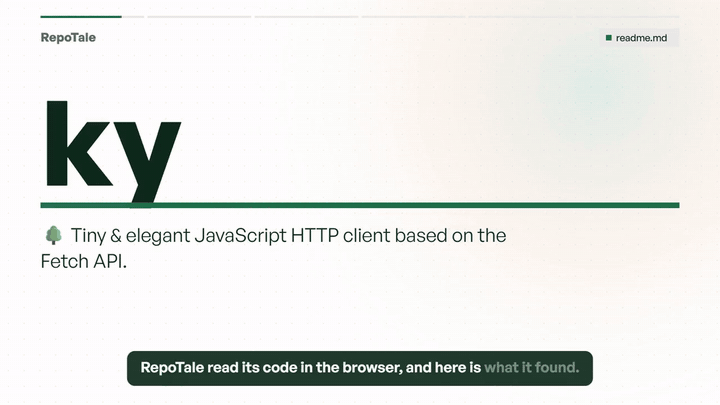

# RepoTale

[](https://harshdubey23.github.io/RepoTale/) [](https://www.npmjs.com/package/@theharshdubey/reporeel) [](https://github.com/HarshDubey23/RepoTale/actions/workflows/ci.yml) 

[](https://harshdubey23.github.io/RepoTale/#demo)

**Understand any codebase, and trust what you are told about it.** Paste a GitHub repository, a pull request or a website into [the site](https://harshdubey23.github.io/RepoTale/), or plug RepoTale into your coding agent. Every answer comes from the real import graph and points at the file and line behind it; nothing is guessed, and nothing that cannot be checked is passed off as fact.

| You want to | Paste or run | You get |
| --- | --- | --- |
| **Review a pull request** | `github.com/owner/repo/pull/123` | What the change can break: every file it reaches through imports, the tests on those paths, the changed files no test reaches, and a verdict (review carefully, worth a look, low reach). Changed files are outlined on the architecture diagram. |
| **Find your way into a new codebase** | `owner/repo` → **Start here** | The five files to read first, in order (the front door, the path to the module everything leans on, then what you meet everywhere), with why each matters and minutes to read. |
| **Ask how something works** | `owner/repo` → **Ask** | An answer from Claude (with your own API key) where every citation is checked against the code: real ones link to the exact lines, invented ones are flagged in red, never hidden. |
| **Give your AI agent the real structure** | `npx @theharshdubey/reporeel mcp` | An MCP server: `impact`, `who_imports`, `explain_file`, `import_path`, `start_here`, `repo_overview`, answered from the import graph of your working tree. |
| **See the architecture** | `owner/repo` | An interactive diagram laid out by ELK, every arrow a real import labelled with what it imports. SVG, PNG, Mermaid. |
| **Explain a project on film** | `owner/repo` or any website link | A narrated film with an original score: titles that rise letter by letter, the system building itself, the camera touring it, the core module typing itself into an editor, live pages scrolling by. Download as MP4 with voice and music, or as a vertical 9:16 cut for Reels, Shorts and TikTok. |

### Plug it into your coding agent

```bash
claude mcp add repotale -- npx -y @theharshdubey/reporeel mcp
```

For Cursor, Windsurf or any MCP client, add a stdio server with the command `npx` and the arguments `-y @theharshdubey/reporeel mcp`, started in your repository. Then ask your agent things like *"what breaks if I change src/db.ts?"* or *"which tests should I run for this diff?"*: it calls `impact` and gets the dependents and the tests from the graph, instead of grepping and guessing.

## The website

Paste `owner/name`, a github.com link, a pull request link or any website. The page reads the repository in your browser, straight from GitHub: nothing is uploaded and nothing is run. Its views:

| View | What it shows |
| --- | --- |
| **Review** (pull requests) | What the pull request can break, its riskiest files first, each changed file with how far it reaches and how many tests sit on its path. Every changed file and the tests named after it are always read, even in a sampled repository |
| **Start here** | The files a newcomer should read first, in order, with the reason for each and minutes to read |
| **Ask** | Questions answered by Claude Opus 5.5 with your own Anthropic key (kept in the tab, sent only to api.anthropic.com). RepoTale picks the files by name, declarations and imports, sends their numbered lines, and checks every citation in the answer against them |
| **Architecture** | The system as one diagram: its components (real files, given readable names) inside their subsystems, the outside services they call (databases, APIs, a headless browser…) and who uses it, laid out top to bottom by ELK with orthogonal arrows. Every arrow is a real import, labelled with what it imports. A file nearly everything imports wears a "used by N" badge instead of drawing a dozen arrows. Drag, scroll or pinch to move around; hover a component to trace what it talks to; select it to open its code on GitHub. Exports as SVG or PNG, dark or light, and as Mermaid that GitHub draws in any markdown file |
| **Film** | A narrated film written from the code. If the project runs on the web, it opens with its real pages, each shown in a browser window that scrolls down the page while the narration says which file defines it. Then the numbers and the stack, and then the architecture on one continuous canvas: the whole system builds itself, and the camera flies to each busy subsystem while the narration names its parts and the import that ties them together, with the file and line on screen. Then the module most files depend on, one path to it, what a change would reach, and what to watch. Captions follow the voice word by word. **Download video** records an MP4 with the voice in it |
| **Files** | Every file read, by area. Select one to see what it defines (with line links), what it imports, what imports it, and how many files and tests a change to it reaches; blast radius lights up every file a change could touch, by distance |
| **Evidence** | Core modules, entry points, import cycles in import order, widely used modules with no test reaching them, the largest files, the stack with the manifest that names each part, and the packages used most |
| **Export** | A share link, a README badge, `graph.json`, and the film as a `reporeel.json` storyboard the CLI renders in HD |

Voices: **Kokoro**, an open neural voice that runs in the browser for free (two American and two British voices, on your graphics card when there is one), or **ElevenLabs** with your own API key, which stays in the tab and goes only to `api.elevenlabs.io`. "Browser voice" is instant but cannot be recorded.

What it can and cannot claim:

- An import is drawn only when it resolves to a file that is in the tree (relative imports, `tsconfig` path aliases, Python packages, Go modules). Anything else is listed as an outside package, never guessed.
- Every link is pinned to the analysed commit, so it keeps pointing at the same line after the code moves on.
- Large repositories are sampled: up to 220 source files, preferring code near the top of the tree over tests and vendored folders. The page says when it is showing a sample.
- Imports and declarations are matched by pattern, not parsed, for JavaScript, TypeScript, Python and Go. Call graphs are not built yet.
- Without a token GitHub allows 60 API requests an hour, and each repository uses three. A fine-grained read-only token lifts that and opens private repositories; it stays in the tab and goes only to `api.github.com`.
- The live site comes from the repository's homepage field, its GitHub Pages site, or a demo link in its README; you can also type it in. Pages are photographed by thum.io's free service, one at a time, at up to 1200 by 1200 pixels; blank or error pages are left out rather than shown. Dynamic routes (`[id]`, `:id`) and translated copies of a page are skipped.
- The Kokoro voice downloads its model once and the browser keeps it: about 330 MB on a graphics card (WebGPU), where it speaks about as fast as real time after a 15 to 30 second warm-up that starts when you press Read; about 90 MB on the processor (`localStorage['repotale.studio'] = 'false'`), which is several times slower than real time. Each scene starts as soon as its voice is ready. On a laptop's built-in graphics chip the page can stutter while the voice is being made.
- The diagram's layout engine (ELK) loads from jsDelivr. Component names come from file and folder names, so they are only as good as those names; nothing is written by a language model.

Run the website locally with any static server, for example `npx http-server web`. It has no build step and no dependencies.

## The CLI

### Tour a web app, signed in

`repotale tour` walks a running web app the way a visitor would, signs in first if you ask it to, reads every page it reaches (headline, sections, buttons, form fields, tables) and writes a storyboard that explains each one. `repotale video` then films it, scrolling and zooming through every page while the narration says what is there.

```bash
REPOTALE_USER=guest@example.com REPOTALE_PASS=... npx @theharshdubey/reporeel tour https://app.example.com/dashboard --login https://app.example.com/login --max 10
```

- Credentials come only from environment variables (`--user-env` and `--pass-env` rename them). They never appear in the storyboard, the video or the command line.
- The sign-in is saved to `.repotale/session.json`, which is added to `.gitignore`; every page scene starts from it. Delete the file to sign out.
- It never follows links that sign out, delete, remove, reset or cancel, and stays on the app's own origin.
- Use a guest or demo account: the tour clicks nothing, but it does load every page that account can see. Forms behind a captcha cannot be signed into.


**Your repo, explained in one command.** reporeel reads a repository and turns it into a narrated video that explains it (the live app, the architecture, the real code, a real test run), then puts that video, a diagram and a chapter list into your README, makes the social preview card, drafts the launch posts, and tells you whether your quickstart actually works.

<!-- reporeel:start -->
<a href="docs/reporeel/reporeel.mp4"></a>

<sub>Silent preview. ▶ <a href="docs/reporeel/reporeel.mp4">Watch the narrated video</a> · <a href="docs/reporeel/reporeel.srt">captions</a></sub>

<details><summary><b>What the video covers</b></summary>

- **0:00** Most repositories never get understood. A visitor gives the README a few seconds, sees a wall of text, and leaves. reporeel fixes that with one command.
- **0:10** First it scores the repo the way a visitor sees it. This little app gets a D: no demo, no license, no way to know what it does.
- **0:20** Then run reporeel with no arguments. It writes a storyboard, records a narrated video, draws the architecture, makes a social card and updates the README. The score goes up on its own.
- **0:33** Web scenes drive the real app, with a cursor that glides, clicks that ripple, and a camera that zooms in on what matters.
- **0:42** Everything lives in one storyboard file. Title cards, live web, real code, diagrams, terminal runs and numbers. A coding agent writes it, or Claude does, or you do.
- **0:56** The narration is spoken by a free local voice, or by ElevenLabs in Hindi and many other languages. Chrome records sharp frames, and ffmpeg puts it all together.
- **1:07** It also checks that your quickstart really works on a clean checkout, makes videos of pull requests, cuts vertical versions for Reels and LinkedIn, and keeps everything fresh on every release.
- **1:20** reporeel. Make your repo understood. This video was made by reporeel, from this storyboard.

### Chapters

0:00 Your repo, explained in one command.
0:10 $ node bin/reporeel.js doctor --dir examples/hello | head -1
0:20 $ node bin/reporeel.js --dir examples/hello --voice none --r
0:33 Web scenes drive the real app, with…
0:42 the whole contract
0:56 How it works
1:07 One tool, fifteen jobs
1:20 npx reporeel

</details>

<details><summary><b>Architecture</b></summary>


</details>
<!-- reporeel:end -->

## Quickstart

```bash
npx @theharshdubey/reporeel
```

Run it in any repository. It prints a first-impression score, does the work, and prints the score again.

Or install it once and use the short command everywhere:

```bash
npm i -g @theharshdubey/reporeel
```

```bash
reporeel
```

## Why

A visitor decides about a repository from its README in a few seconds. Most READMEs give them a wall of text and no way to see the thing working. A good demo video fixes that, and nobody makes one, because it means writing a script, recording the app, recording a voice-over, syncing them and keeping all of it current. reporeel does that part.

## What it does

| Command | What you get |
| --- | --- |
| `reporeel` | Everything below in order, with the score before and after |
| `reporeel doctor` | A first-impression score out of 100 with the fix for each gap: README, one-line description, demo media above the fold, quickstart, license, tests, CI, broken links, **committed secrets and `.env` files**, huge files |
| `reporeel graph` | Maps the code without running it: modules, top-level symbols and the imports between them (TypeScript, JavaScript, Python) as `graph.json`, plus `explore.html`, a page to click through who imports what and which tests reach a file |
| `reporeel check` | Says whether every scene is backed by the repository (a file, line range, symbol or test that exists) and whether the last render is out of date with the code it cites |
| `reporeel verify` | Shows you the commands in your README's setup section, and once you approve them runs them on a clean clone and tells you the first one that breaks |
| `reporeel plan` | Writes `reporeel.json`, the storyboard. With `ANTHROPIC_API_KEY` Claude reads the repo and writes it; without one you get an offline draft from your manifests and README |
| `reporeel video` | Renders the storyboard: MP4 with voice and chapters, a silent GIF for the README, `.srt` captions, a poster frame and a contact sheet. Unchanged scenes come from a cache; `--only 3` previews one scene in seconds |
| `reporeel diagram` | Architecture diagram as SVG and PNG, from the storyboard or straight from your manifests |
| `reporeel shots` | Screenshots of the running app: desktop and phone, dark and light |
| `reporeel social` | The 1280x640 GitHub social preview card, **vertical (9:16) and square cuts** of the video for Reels, Shorts and the LinkedIn feed, and `LAUNCH.md` with drafts for Show HN, LinkedIn, X and Reddit. Drafts only: it never posts |
| `reporeel readme` | Puts the GIF, the video link, the chapters and the diagram into your README between markers. Re-running replaces its own block and touches nothing else |
| `reporeel pr` | A short video of what the current branch changes: the commit, the size, the changed lines lit up in the code, and the tests run on it |
| `reporeel dub --lang hi` | Translates the narration (Claude) and re-voices the video (ElevenLabs) in Hindi or any other language |
| `reporeel ci` | A GitHub Action that runs `doctor` and `verify` on pull requests with a read-only token, and refreshes the media on every release |
| `reporeel setup` | Checks Node, ffmpeg, Chromium and your keys, and tells you how to fix each one; `--fix` installs Chromium |

## The storyboard

Everything the video says and shows lives in `reporeel.json`, so it can be reviewed, diffed and re-rendered when the app changes:

```json
{
  "title": "Readable",
  "app": { "url": "http://localhost:4321/", "start": "node server.js" },
  "voice": { "provider": "kokoro" },
  "scenes": [
    { "type": "title", "heading": "How long will this take to read?", "say": "Readable tells you how long any text takes to read, and how hard it is." },
    { "type": "web", "actions": [{ "type": ["#text", "Paste anything."] }, { "click": "#measure" }, { "zoom": "#result" }], "say": "Paste some text and press measure." },
    { "type": "code", "file": "readable.js", "lines": [1, 10], "highlight": [[8, 8]], "say": "The score is the Flesch reading ease formula." },
    { "type": "terminal", "commands": ["npm test"], "say": "And the tests run, for real." },
    { "type": "end", "heading": "Readable", "links": ["github.com/you/readable"], "say": "Try it yourself." }
  ]
}
```

| Scene | Shows | Notes |
| --- | --- | --- |
| `title` | A title card | The hook |
| `web` | Your running app | Actions: `click`, `type`, `press`, `hover`, `scroll`, `zoom`, `wait`, `waitFor`. The cursor glides, clicks ripple, `zoom` moves the camera onto an element. A scene lasts as long as its narration or its actions, whichever is longer |
| `code` | Real lines from a file | Syntax-highlighted; `highlight` ranges are lit up one after another |
| `diagram` | A Mermaid diagram | Nodes appear as they are talked about |
| `terminal` | Commands and their output | The commands **really run** before recording, after you approve them; a failing test shows as failing |
| `stats` | Big numbers | They count up |
| `end` | Closing card with links | |

Any scene can carry `say_hi`, `say_ta` and so on; `reporeel video --lang hi` uses them.

Generated storyboards start with `"$schema"`, so VS Code and other editors autocomplete every field and underline mistakes. The schema is [`schema/reporeel.schema.json`](schema/reporeel.schema.json); a complete example is [`examples/hello/reporeel.example.json`](examples/hello/reporeel.example.json).

### A fast loop

```bash
npx @theharshdubey/reporeel video --only 3      # preview scene 3 alone, in docs/reporeel/preview.mp4
npx @theharshdubey/reporeel video               # everything; scenes you did not touch are reused
npx @theharshdubey/reporeel video --fresh       # record every scene again
```

## Use it from Claude Code or Codex

Copy `skills/reporeel` into your skills folder (for Claude Code, `~/.claude/skills/`) and ask *"make a demo video of this repo"*. The agent reads the code, starts the app, finds real selectors, writes the storyboard, renders, looks at the contact sheet and fixes what is wrong. No API key is needed, because the agent is the one doing the thinking.

## Voices

| Provider | Cost | Languages | Setup |
| --- | --- | --- | --- |
| `kokoro` (default) | Free, runs on your machine | English | Nothing. The model (about 90 MB) downloads on first use |
| `elevenlabs` | Your ElevenLabs plan | Hindi and many more | `ELEVENLABS_API_KEY` |
| `none` | Free | | Silent video, captions only |

Narration is cached by its text, so re-rendering after a visual fix does not regenerate audio.

## Requirements

Node 22.18 or newer and a Chromium for Playwright. ffmpeg is used from your PATH, from `REPOREEL_FFMPEG`, or from the bundled `ffmpeg-static`. Run this once:

```bash
npx @theharshdubey/reporeel setup --fix
```

## Use it as a library

```js
import { doctor, draft, render } from '@theharshdubey/reporeel';

const report = doctor('.');                       // { score, grade, checks, secrets }
const storyboard = draft('.');                    // or write your own
await render(storyboard, './reporeel.json', { out: 'docs/reporeel', approve: cmds => true }); // approve gets the commands it will run
```

Type declarations are included.

## How it is built

- Frames come from Chrome's screencast (full-resolution JPEGs), not Playwright's VP8 recorder, so code and UI text stay sharp.
- Each scene is cached by everything that changes how it looks or sounds (its JSON, its narration audio, the code file it shows, the theme), so only edited scenes are recorded again. Web scenes show a live app and are always recorded.
- Chapters are written into the MP4, so players can jump between scenes.
- Built-in scenes are small HTML pages that animate themselves for exactly the length of their narration, recorded the same way as your app.
- A failed web action is reported and skipped instead of killing a two-minute render; an app that will not start drops its web scenes with a warning, and the rest of the video is still made.
- `doctor` and `verify` never run anything from your working tree: `verify` uses a fresh clone, `doctor` only reads files.

## Evidence

A video about code should be checkable against the code. Any scene can cite what backs it:

```json
{ "type": "stats", "heading": "Safe by default", "items": [{ "value": "0", "label": "commands run unasked" }],
  "say": "Nothing from the repository runs until you approve it.",
  "evidence": [{ "kind": "symbol", "id": "src/exec.ts#mustApprove" }, { "kind": "test", "id": "test/security.test.ts" }] }
```

`reporeel check` sorts every scene into one of four kinds:

| | Meaning |
|---|---|
| `observed` | A `web` or `terminal` scene: recorded from the running app or a real command run |
| `grounded` | A `code` scene, or a scene whose evidence all resolves to a file, a line range, a symbol or a test |
| `unsupported` | A `diagram` or `stats` scene that cites nothing |
| `broken` | It cites something that is not in the repository. `video` refuses to render until this is fixed |

Every render writes `evidence.json` next to the video: the commit, and a hash of each cited line range. Run `check` later and it names the scenes whose code has changed since, so you know which parts of the video to redo. `reporeel pr` uses the same import graph to say how many modules depend on the changed files and which test files reach them.

What this does and does not prove: a `grounded` scene cites something that exists at that commit. It does not prove the narration describes it correctly. The graph is built by matching declarations and imports, not by parsing: it lists top-level symbols and imports that resolve to a file, and it does not trace calls.

With `ANTHROPIC_API_KEY` set, `reporeel plan --audience executive|developer|architecture|walkthrough|demo` asks Claude for a different cut of the same repository: a 30-second pitch, a first-day introduction, a deep dive, one feature end to end, or the product with no code. The evidence rules are the same for all of them.

The static parts were run on 20 real repositories (Express, Vite, Django, FastAPI and others): [bench/RESULTS.md](bench/RESULTS.md) has the numbers, the commits, and what they do not measure. `node bench/run.ts` reproduces it.

## What reporeel runs, and when

A README and a storyboard are input, and a storyboard may have been written by a model that read someone else's repository. So:

- `doctor`, `plan`, `graph`, `check`, `diagram`, `social` and `readme` run nothing from the repository.
- `video`, `pr`, `shots` and `verify` list the exact commands they need (terminal scenes, `app.start`, README setup blocks) and ask before running any of them. `--run` approves up front, for CI. With no terminal and no `--run`, they refuse.
- Those commands do not see environment variables that look like credentials (`*KEY*`, `*TOKEN*`, `*SECRET*`, `*PASSWORD*`, `*AUTH*`). `REPOREEL_PASS_ENV=NAME,NAME` lets named ones through.
- Code scenes can only show files inside the repository, and web scenes only `http`/`https` pages.
- Approval alone is consent, not a sandbox: an approved command has your user's file and network access. For a repository you do not trust, add `--sandbox` (needs Docker). Terminal scenes and `verify` steps then run in a throwaway container that sees the repository and nothing else of your machine, has no network unless you add `--net`, gets none of your environment, and is limited in memory, CPU, processes and time. `--sandbox python:3.12-slim` picks another image; the default is `node:22-slim`.
- What `--sandbox` does not cover: `app.start` still runs on your machine, because the browser has to reach it, and the container can write to the mounted repository. A container is not a VM.

## Limits

- The offline `plan` draft is a starting point, not a script. The good videos come from a storyboard written by an agent, by Claude, or by you.
- `verify` runs your README's commands once you approve them. It skips ones that obviously need a person (`cd`, `export`, placeholders); the skip list is a convenience, not a safety filter.
- Web scenes need an app that runs locally; apps that need a database or secrets need those set up first.
- GitHub does not autoplay video in a README, which is why the README gets a silent GIF that links to the MP4. To get an inline player, drag the MP4 into the README editor on github.com.

## Contributing

Issues and pull requests are welcome; see [CONTRIBUTING.md](CONTRIBUTING.md). `npm test` runs the unit tests and an end-to-end render of the example app. `node bin/reporeel.js video` in this repository re-renders the video at the top of this README.

## License

MIT
